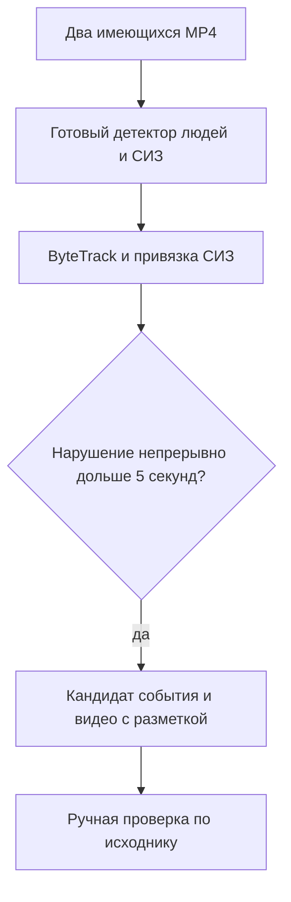
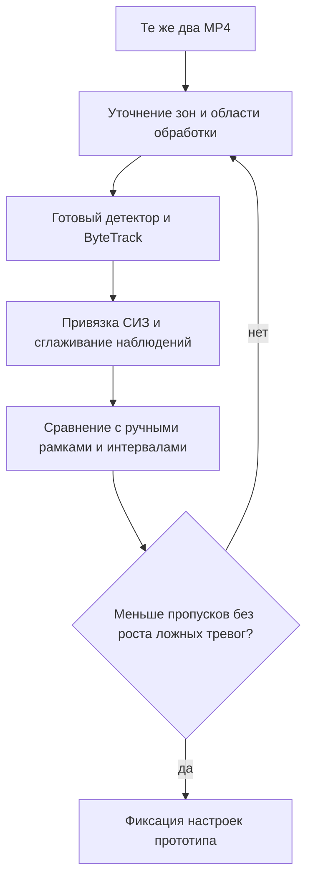

# ML System Design Doc: видеоконтроль опасных зон и СИЗ на складе

СИЗ - каска и сигнальный жилет. Опасная зона - участок кадра, который я размечаю вручную для каждой камеры (например, где ездит погрузчик)

## 1. Цели и предпосылки

### 1.1. Зачем идём в разработку продукта

Сейчас нарушения на складе ищут вручную: инженер по охране труда иногда пересматривает записи камер. Всё пересмотреть нельзя, поэтому большинство нарушений никто не видит

Система будет сама смотреть камеры и сразу присылать тревогу с коротким клипом. Человеку останется только подтвердить её или отклонить

Успех итерации: на 1–2 камерах система находит нарушения лучше бейзлайна и не спамит ложными тревогами

### 1.2. Бизнес-требования и ограничения

Что должна делать система:

- замечать человека в опасной зоне дольше 5 секунд;
- замечать человека без каски или жилета;
- присылать тревогу с клипом в течение ~10 секунд;
- давать оператору отметить тревогу как верную или ложную;
- хранить журнал нарушений.

Ограничения:

- камеры уже стоят, у всех разный ракурс и свет
- сервер без GPU
- на видео люди, поэтому без распознавания лиц, храним только клипы нарушений
- решения по людям принимает человек, а не система
- если много ложных тревог, то оператор перестанет на них смотреть

Пилот: размечаю зоны на 1–2 камерах, неделю система работает в тихом режиме (тревоги пишутся в журнал, но никому не отправляются), потом включаю уведомления. Пилот успешный, если находим хотя бы 80% нарушений и бывает не больше 5 ложных тревог на камеру за смену. Цифры примерные, уточню после бейзлайна.

### 1.3. Что входит в скоуп, что нет

Входит: оба сценария на 1–2 камерах, бейзлайн и MVP, свой тестовый набор видео, метрики по каждой камере.

Не входит: падения, детекция погрузчиков, распознавание лиц, работа на многих камерах и GPU, автоматическое переобучение.

Код: Python, ruff, pre-commit, pytest, GitHub Actions, Docker.

Оставляю на потом: ручной подбор порогов, мониторинг дрифта. Ещё готовые модели СИЗ обычно под лицензией AGPL - для коммерции их пришлось бы переобучить.

### 1.4. Предпосылки решения

- Камеры не двигаются, поэтому зону можно один раз нарисовать на кадре
- Хватит 2–5 кадров в секунду: нарушение длится несколько секунд. Это позволяет обойтись без GPU
- Решаю по нескольким кадрам подряд, а не по одному, чтобы было меньше ложных тревог
- Камеры разные, поэтому метрики и пороги считаю для каждой отдельно
- Данные: готовые модели (обучены в основном на стройках)

## 2. Методология

### 2.1. Постановка задачи

Это поиск нарушений на видео. Детектор находит людей, каски и жилеты, трекер ByteTrack следит за каждым человеком между кадрами, а простые правила решают, есть ли нарушение:

- человек в зоне - его ноги внутри зоны дольше 5 секунд
- нет СИЗ - на большинстве кадров у человека нет каски или жилета

Метрики: сколько нарушений нашли, сколько тревог были верными, сколько ложных тревог за смену и как быстро приходит тревога. Считаю по каждой камере отдельно

### 2.2. Блок-схема решения

Текущая итерация — офлайн-прототип на **Camera_0000.mp4 и input.mp4**.
Доступно 2229 кадров, 77,16 секунды. Других видео, новых съёмок и промышленного
пилота в этой итерации нет. Общие бизнес-требования раздела 1 остаются ориентиром,
а текущие выводы ограничены этими двумя записями.

Бейзлайн — готовый детектор и строгие правила без обучения:

MVP — те же веса; улучшаю обработку и временные правила:

### 2.3. Этапы решения задачи

В ДЗ2 пересчитаны EDA и предразметка всех кадров двух роликов, проведён первичный
аудит. Исправление рамок и интервалов, улучшенный MVP и замеры CPU ниже описаны
как следующий этап, а не как выполненные эксперименты.

#### Этап 1. Подготовка данных

Результаты: [EDA](../reports/eda/README.md), [измерения видео](../reports/eda/videos.csv),
[оценка предразметки](../reports/annotations/README.md).

| Данные | Источник и состав | Качество и готовность |
| --- | --- | --- |
| Camera_0000.mp4 | Локальный MP4, 1920×1080, 30 FPS, 60 секунд, 1800 кадров | видны люди в СИЗ и без них, перекрытия и проезд погрузчика |
| input.mp4 | Локальный MP4, 898×506, 25 FPS, 17,16 секунды, 429 кадров | меньше деталей, мелкие каски, нестабильные треки |
| Полигон зоны | По одному вручную нарисованному полигону на ролик, нормированные координаты в JSON | Демонстрационные границы, не реальные производственные запреты |

Оба файла предоставлены с проектом; новых поступлений и регулярных выгрузок нет.

Суммарно 20,386 МБ, 2229 кадров и 77,16 секунды. Для качества измерены 78 кадров
примерно по одному в секунду: яркость, контраст, резкость, тени, светлые участки
и изменения между выбранными кадрами. Расхождений числа кадров и точных повторов
в выборке нет; пороги тёмных, малоконтрастных и размытых кадров не сработали.
Это не гарантирует видимости каждой головы и жилета.

Входные признаки - изображение, время кадра, ID ролика и полигон; далее рамки,
положение ног, связь СИЗ с человеком и история трека.

| Целевая разметка | Получение | Текущее состояние |
| --- | --- | --- |
| Рамки person/helmet/vest и отрицательных классов | Автопредразметка, затем ручное исправление | Все 2229 кадров обработаны, но не проверены полностью вручную |
| ID трека и видимость головы/торса | ByteTrack и модельные наблюдения, затем проверка | Unknown не считается отсутствием СИЗ; ID могут меняться |
| Тип и интервал события, камера и человек | Ручной просмотр, сравнение с правилами | 4 кандидата zone, 0 выделенных событий СИЗ со строгим правилом > 5 сек. полный эталон интервалов ещё не создан |

Получено 2583 рамки person, 962 helmet, 434 vest, 82 no_helmet и 332 no_vest.
Это появления меток в кадрах, а не уникальные объекты или истинный баланс классов.
Визуальная сверка 20 кадров: person 33 против 23 автоматически, helmet 7 против 7,
vest 21 против 8; среднее расхождение на кадр 0,50 / 0 / 0,65.
У 59,81% рамок людей каска unknown, у 70,73% — жилет unknown.
В `input` медианная высота найденной каски 14,99 пикселя против 58,98 у `Camera_0000`;
42,53% рамок людей `input` не имеют подтверждённого ID. Основные риски - мелкие СИЗ,
перекрытия, пропуски детектора, дробление треков и малый объём наблюдений.

Для офлайн-прототипа дополнительное количество видео - 0: используются только
эти два. Нехватку данных для обучения обхожу готовыми весами без дообучения;
аннотации улучшаю на существующих кадрах. Это не решает нехватку независимых сцен
для общей оценки качества. Извлечение ещё кадров не создаёт новых наблюдений.
Для проверки FP за смену и промышленного пилота данных недостаточно;
эти результаты в текущей итерации не заявляются.

На видео люди и складские надписи. Оригиналы и видео с наложением хранятся локально,
в Git - агрегаты, аннотации без изображений и код. При передаче кадров скрываются
лица и надписи, доступ и срок хранения согласуются с владельцем. Личности не распознаются.

Результат этапа: два проверенных MP4, два полигона, исправленные рамки/видимость
и интервалы для доступных эпизодов. Пока выполнены техническая проверка,
автопредразметка и аудит количества; полный ручной эталон остаётся следующей работой.

#### Этап 2. Подготовка прогнозных моделей

Бейзлайн: YOLOv8s Construction Site Safety Hazards v0.3 с готовыми весами,
resize с сохранением пропорций, letterbox, imgsz=1280, confidence=0,25, NMS,
ByteTrack для людей. Обработаны все кадры с исходными 30/25 FPS, на GPU;
веса, ревизия и хеш зафиксированы в [manifest.json](../data/annotations/manifest.json).
Для CPU отдельно планируется проверить вход 640 и 2 FPS - замеры ещё не выполнены.

СИЗ назначается одному человеку по положению головы и торса. Отсутствие детекции
не означает отсутствие СИЗ: при нехватке или конфликте свидетельств ставится unknown.
Правила бейзлайна требуют непрерывных положительных свидетельств нарушения > 5 секунд.

MVP без дообучения: те же веса, уточнённая область прохода, привязка СИЗ,
буфер трекера и временное сглаживание. Признаки правил - положение ног в зоне,
статус каски/жилета, длительность и история трека. Небольшой перебор: вход
640/960/1280, confidence 0,25/0,4, 2/5 FPS; выбирать по пропускам, FP и скорости CPU.
Обучающие аугментации и отдельная обучающая выборка не используются.

Потери выбранного семейства детектора - BCE для классов, CIoU и DFL для рамок:
BCE отвечает за ошибку класса, CIoU - геометрию, DFL - точность границ мелких СИЗ.
В этой итерации loss не оптимизируется, поскольку обучение не проводится.

Валидация: `Camera_0000` - набор для настройки правил, `input` - ограниченная
проверка другого ракурса после фиксации параметров. Весов модели это разделение
не касается: они заморожены. Оба видео уже просмотрены в EDA, поэтому сравнение
исследовательское, а не слепой независимый test. Соседние кадры, один эпизод и
один человек не считаются независимыми примерами; случайное 60/20/20 не применяется.
Если существующие ролики связаны одной съёмкой, проверка переноса ещё слабее;
связь источников пока не подтверждена. На новые смены результат не обобщается.

Метрики детектора - mAP@0.5:0.95 и recall по person/helmet/vest после исправления
ручных рамок: они показывают локализацию и пропуски мелких СИЗ. Пока рассчитано
только расхождение количества объектов на 20 кадрах, оно не заменяет mAP.
Для правил — precision/recall событий по типам, число FP на каждом ролике,
скорость обработки, RAM и p95 задержки записи тревоги на CPU. Пропуски опасны,
а FP отвлекают оператора; задержка и ресурсы отражают ограничения сервера.

Совпадение события: тот же ролик, человек и тип, временной IoU ≥ 0,3;
сопоставление один к одному. Лишнее событие - FP, пропущенный размеченный эпизод - FN.
При отсутствии эталонных эпизодов класса recall не определён; рядом с метрикой
указываю число событий. Цель MVP - уменьшить пропуски относительно строгого
бейзлайна без роста FP на этих же двух видео. FP за смену и общая точность
на новых сценах по 77,16 секунды не оцениваются.

Анализ: просмотр FP/FN по каждому ролику, мелким объектам, перекрытиям и сменам ID.
Уже выявлены пропуски жилетов, людей в `input` и длительного отсутствия СИЗ
в `Camera_0000`. Риски: мало примеров - ограничить выводы; подгонка параметров -
малый фиксированный перебор; неизвестная видимость - unknown; медленный CPU -
меньший вход, частота обработки и ONNX Runtime. Нехватку независимых данных
эти меры не устраняют.

Результат этапа: веса и параметры двух вариантов, сравнение на одинаковой ручной
разметке, список ошибок и замеры CPU. Пока выполнены базовый прогон и первичный
аудит; полноценные модельные метрики и сравнение улучшенного MVP ещё предстоят.

#### Этап 3. Правила зон и СИЗ

Бейзлайн уже реализован: точка между ногами внутри демонстрационного полигона
непрерывно > 5 секунд - zone; непрерывные предсказания отсутствия каски/жилета
> 5 секунд — no_helmet/no_vest. Пропуск, unknown или смена ID сбрасывают накопление.
Время считается по шкале видеозаписи; исходный масштаб времени съёмки неизвестен.

Выделены 4 кандидата zone в `Camera_0000` и 0 в `input`, событий СИЗ - 0.
Это ошибки и ограничения бейзлайна, а не доказательство отсутствия нарушений.
В `Camera_0000` человек в белой футболке без каски и жилета виден дольше 5 секунд,
но эпизод пропущен. У ID=2 есть 843 наблюдения около 28 секунд; серия предсказанного
отсутствия каски длится максимум 0,867 секунды, жилета - 1,600 секунды.
Unknown и пропуски обрывают накопление, поэтому блок СИЗ пока не справляется
с этим сценарием. В `input` ни один подтверждённый ID не покрывает 5 секунд.

План MVP: для зоны допускается краткая потеря трека до секунды с явным учётом
неопределённости; более долгий пропуск сбрасывает состояние. Для СИЗ - окно
5 секунд, не менее 8 пригодных наблюдений при 2 FPS и отсутствие СИЗ в ≥ 80%
из них. Неизвестная видимость не становится отрицательным примером.
Одна тревога на непрерывный эпизод человека и типа; после устранения нарушения
или выхода состояние сбрасывается. Эффект этих изменений проверяется по ручным
интервалам, улучшение заранее не считается достигнутым.

На `Camera_0000` сравниваю окно 3/5 секунд и долю 70/80/90%, затем фиксирую
параметры для `input`. Автор проверяет положение демонстрационных полигонов.
Случаи проверки: пребывание короче/дольше 5 секунд, граница зоны, перекрытие,
смена ID, несколько людей, пропущенные СИЗ и повторное нарушение.
Результат: объяснимые события и сравнение пропусков/FP на двух видео.

#### Этап 4. Инференс и проверка на складе

В этой итерации проверка склада - только офлайн-проигрывание двух имеющихся MP4.
Сохраняются JSON каждого кадра, YOLO-аннотации, CSV событий и полные видео с наложением.
Нарезка клипов ±5 секунд, измерение скорости, RAM и задержки на целевом CPU -
следующая работа. GPU-прогон предразметки не подтверждает производительность на CPU.

Для MVP повторно проигрываю оба ролика с фиксированными настройками и сравниваю
с полной ручной разметкой, включая участки без тревог. Повторный прогон не считается
новым наблюдением. Реальных камер, новых смен и недели тихого режима не будет;
цели промышленного пилота из раздела 1 остаются за пределами доступной проверки.

При перегрузке уменьшаю вход или частоту обработки; при ошибке чтения MP4
фиксирую сбой, а не отсутствие нарушений. Если улучшения нет, оставляю бейзлайн
и описываю причины. Результат - протокол локального сравнения двух вариантов
на двух роликах с ресурсами и ограничениями, а не подтверждение промышленной готовности.

## Дополнительно

Текущему прототипу достаточно локальных видео, скриптов и файлов результатов.
RabbitMQ, FastAPI, PostgreSQL и S3 - возможная будущая архитектура, её развёртывание
и подключение новых источников в эту итерацию не входят.

Главные риски:

- готовая модель пропускает СИЗ - ручная проверка и сравнение настроек;
- всего 77,16 секунды - выводы ограничены двумя роликами;
- стеллажи и мелкие объекты ухудшают детекцию и ID - анализ размеров и треков;
- CPU может не обеспечить нужную скорость - отдельный замер до выбора конфигурации.
