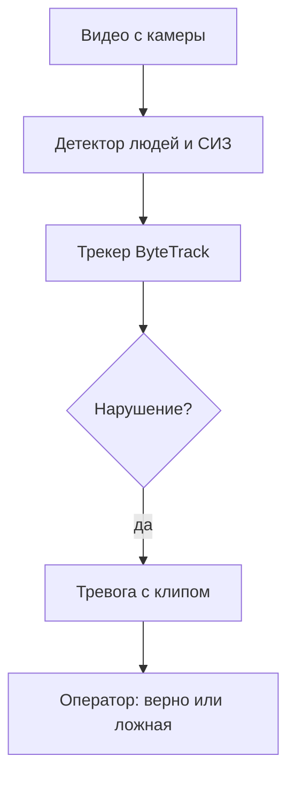
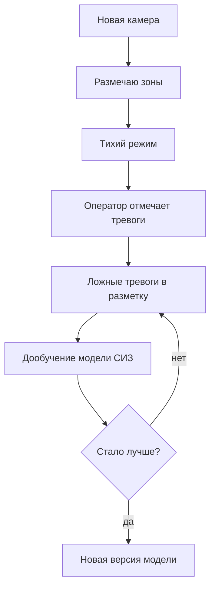

# ML System Design Doc: видеоконтроль опасных зон и СИЗ на складе

СИЗ - каска и сигнальный жилет. Опасная зона - участок кадра, который я размечаю вручную для каждой камеры (например, где ездит погрузчик)

## 1. Цели и предпосылки

### 1.1. Зачем идём в разработку продукта

Сейчас нарушения на складе ищут вручную: инженер по охране труда иногда пересматривает записи камер. Всё пересмотреть нельзя, поэтому большинство нарушений никто не видит

Система будет сама смотреть камеры и сразу присылать тревогу с коротким клипом. Человеку останется только подтвердить её или отклонить

Успех итерации: на 1–2 камерах система находит нарушения лучше бейзлайна и не спамит ложными тревогами

### 1.2. Бизнес-требования и ограничения

Что должна делать система:

- замечать человека в опасной зоне дольше 5 секунд;
- замечать человека без каски или жилета;
- присылать тревогу с клипом в течение ~10 секунд;
- давать оператору отметить тревогу как верную или ложную;
- хранить журнал нарушений.

Ограничения:

- камеры уже стоят, у всех разный ракурс и свет
- сервер без GPU
- на видео люди, поэтому без распознавания лиц, храним только клипы нарушений
- решения по людям принимает человек, а не система
- если много ложных тревог, то оператор перестанет на них смотреть

Пилот: размечаю зоны на 1–2 камерах, неделю система работает в тихом режиме (тревоги пишутся в журнал, но никому не отправляются), потом включаю уведомления. Пилот успешный, если находим хотя бы 80% нарушений и бывает не больше 5 ложных тревог на камеру за смену. Цифры примерные, уточню после бейзлайна.

### 1.3. Что входит в скоуп, что нет

Входит: оба сценария на 1–2 камерах, бейзлайн и MVP, свой тестовый набор видео, метрики по каждой камере.

Не входит: падения, детекция погрузчиков, распознавание лиц, работа на многих камерах и GPU, автоматическое переобучение.

Код: Python, ruff, pre-commit, pytest, GitHub Actions, Docker.

Оставляю на потом: ручной подбор порогов, мониторинг дрифта. Ещё готовые модели СИЗ обычно под лицензией AGPL - для коммерции их пришлось бы переобучить.

### 1.4. Предпосылки решения

- Камеры не двигаются, поэтому зону можно один раз нарисовать на кадре
- Хватит 2–5 кадров в секунду: нарушение длится несколько секунд. Это позволяет обойтись без GPU
- Решаю по нескольким кадрам подряд, а не по одному, чтобы было меньше ложных тревог
- Камеры разные, поэтому метрики и пороги считаю для каждой отдельно
- Данные: готовые модели (обучены в основном на стройках)

## 2. Методология

### 2.1. Постановка задачи

Это поиск нарушений на видео. Детектор находит людей, каски и жилеты, трекер ByteTrack следит за каждым человеком между кадрами, а простые правила решают, есть ли нарушение:

- человек в зоне - его ноги внутри зоны дольше 5 секунд;
- нет СИЗ - на большинстве кадров у человека нет каски или жилета.

Метрики: сколько нарушений нашли, сколько тревог были верными, сколько ложных тревог за смену и как быстро приходит тревога. Считаю по каждой камере отдельно

### 2.2. Блок-схема решения

Бейзлайн — только готовые модели и правила, без обучения:

MVP — дообучаю модель СИЗ на кадрах со склада, а ответы оператора использую как разметку:

Разделы 2.3, 3 и 4 заполню после того, как сниму видео и замерю бейзлайн.

## Дополнительно

Как устроена система: ML-часть обрабатывает видео и отправляет события в RabbitMQ, сервис на FastAPI сохраняет их в PostgreSQL и шлёт уведомления, клипы лежат в S3.

Главные риски:

- готовые модели обучены на стройках, на складе могут работать хуже, поэтому дообучение
- реальных нарушений мало - снимаю инсценировки
- человека может закрыть стеллаж, трекер может его потерять
- CPU может не потянуть... проверю на бейзлайне
