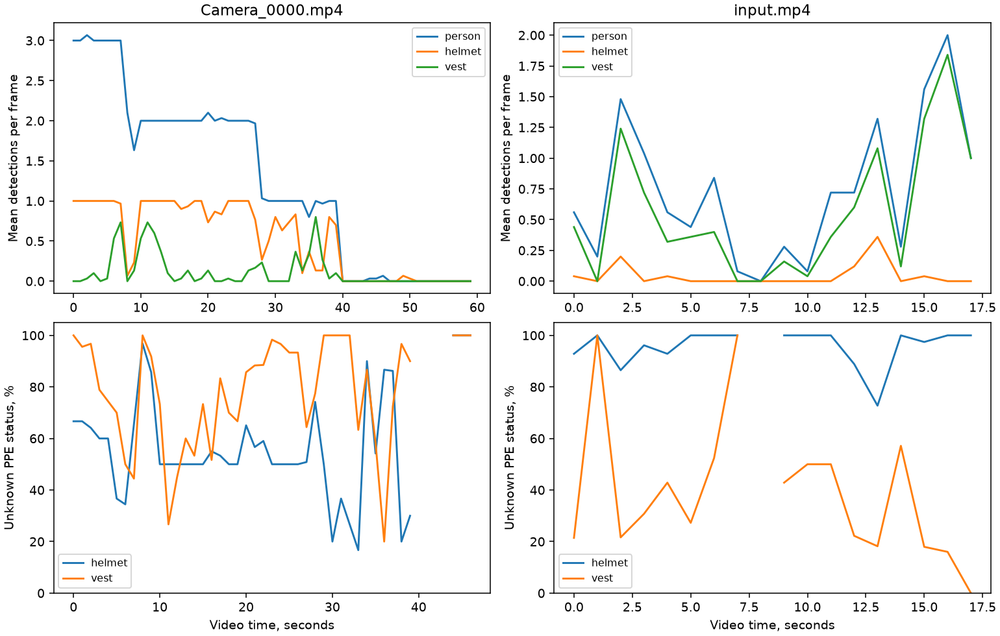
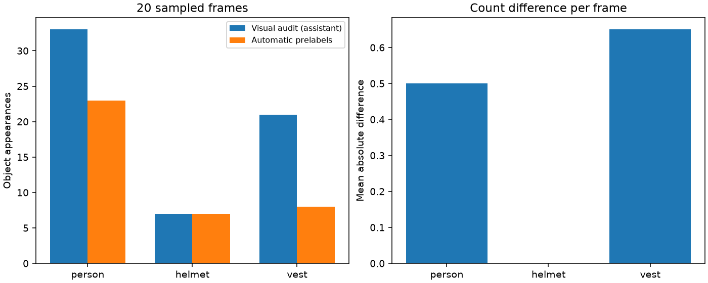

# Предразметка двух видео и оценка ошибок

Набор: **Camera_0000.mp4 и input.mp4**, 1800 + 429 = **2229 кадров**.
Автопредразметка заново выполнена на каждом кадре обоих роликов.
Это демонстрационные модельные метки, а не полностью исправленный ручной эталон.

## Файлы и воспроизведение

В [data/annotations](../../data/annotations/) оставлены только эти два ролика:

- `Camera_0000.jsonl.gz`, `input.jsonl.gz` — одна JSON-запись на кадр, включая пустые;
- `Camera_0000_yolo.zip`, `input_yolo.zip` — TXT каждого кадра для YOLO, без изображений;
- [manifest.json](../../data/annotations/manifest.json) — модель, хеш весов и параметры;
- [summary.csv](../../data/annotations/summary.csv), [events.csv](../../data/annotations/events.csv);
- [visual_audit.csv](../../data/annotations/visual_audit.csv) — сохранённая визуальная сверка 20 кадров.

JSON: `frame` начинается с 0, `time_s` — время файла, `bbox` — x1,y1,x2,y2
в исходных пикселях. YOLO: `class center_x center_y width height`, нормировано
на исходные размеры. Классы: 0 person, 1 helmet, 2 no_helmet, 3 vest, 4 no_vest.
`person_index` у СИЗ — индекс среди person этого кадра; track_id действует
внутри своего видео, null означает неподтверждённый трек.
Все записи сохраняют `reviewed=false`: аудит количества объектов не является
полной ручной корректировкой рамок и атрибутов каждого кадра.

Локальные видео с наложением: [Camera_0000](previews/Camera_0000.mp4),
[input](previews/input.mp4). Они исключены из Git вместе с оригиналами.

Детектор — [Construction Site Safety Hazards v0.3](https://huggingface.co/constructelligence/construction-site-safety-hazards),
YOLOv8s, веса AGPL-3.0. Resize с сохранением пропорций, letterbox, imgsz=1280,
confidence ≥ 0,25; инференс всех кадров, ByteTrack только для людей. Весам не
проводилось дообучение. Получено на RTX 5060, PyTorch 2.11.0, Ultralytics 8.4.212.

СИЗ назначается одному геометрически подходящему человеку: каска у головы,
жилет у торса. Противоречивое наблюдение или отсутствие подходящей детекции — unknown.
`head_visibility/torso_visibility=model_evidence` означает модельное свидетельство,
а не ручную оценку видимости. Необнаруженная каска не равна отсутствующей каске.

## Состав автоматических меток

| Показатель | Camera_0000 | input |
| --- | ---: | ---: |
| Кадров | 1800 | 429 |
| Рамок person | 2275 | 308 |
| Рамок helmet / no_helmet | 942 / 79 | 20 / 3 |
| Рамок vest / no_vest | 205 / 331 | 229 / 1 |
| Подтверждённых ID треков | 6 | 22 |
| Рамок людей без подтверждённого ID | 12 (0,53%) | 131 (42,53%) |
| Кадров без детекции person | 604 (33,56%) | 204 (47,55%) |
| Статус каски unknown, % рамок людей | 55,25 | 93,51 |
| Статус жилета unknown, % рамок людей | 76,44 | 28,57 |

Суммарно: 2583 person, 962 helmet, 434 vest, 82 no_helmet, 332 no_vest.
Это количество появлений меток в кадрах, не уникальных людей или эпизодов.
Кадр без детекции person может быть как пустым, так и содержать пропущенного
человека: у `Camera_0000` в конце есть пустой проход, а у `input` часть людей не найдена.
Точное число пропусков на всех кадрах без ручного эталона неизвестно.



На `Camera_0000` число людей последовательно уменьшается, но находящиеся рядом
СИЗ детектируются не на каждом кадре. На `input` детекции и ID заметно прерывисты.
Нижние графики показывают долю unknown среди найденных людей за каждую секунду;
разрывы линии означают отсутствие детекций person, а не нулевую долю unknown.
Детальные значения: [timeline.csv](timeline.csv), [frame_stats.csv](frame_stats.csv).

## Размеры объектов и confidence

| Класс | Медианная высота, Camera_0000 / input, px | Средний confidence, Camera_0000 / input |
| --- | ---: | ---: |
| person | 228,13 / 109,09 | 0,715 / 0,595 |
| helmet | 58,98 / 14,99 | 0,506 / 0,311 |
| vest | 118,53 / 45,74 | 0,374 / 0,549 |

Все 20 обнаруженных касок `input` ниже 32 пикселей, у `Camera_0000` таких нет.
Это объясняет риск нестабильной детекции мелких СИЗ, но не измеряет размеры
пропущенных объектов. Порог 32 пикселя выбран как диагностический ориентир.
Confidence — оценка детектора, а не измеренная вероятность правильности метки.
Не удалось связать с человеком 3 каски `Camera_0000`, 1 каску и 9 жилетов `input`.
Полная статистика пяти классов: [object_stats.csv](object_stats.csv).

## Визуальный аудит

По 10 равномерных кадров каждого ролика, включая первый и последний, ранее
просмотрены ассистентом в оригинале и с увеличением. После нового инференса
сравнение пересчитано только для этих 20 кадров. Неуверенные дальние фигуры
и неразличимые перекрытые СИЗ исключены; причины сохранены в visual_audit.csv.



| Ролик | Класс | Визуально / автоматически | Среднее абсолютное расхождение на кадр |
| --- | --- | ---: | ---: |
| Camera_0000 | person | 14 / 14 | 0 |
| Camera_0000 | helmet | 6 / 6 | 0 |
| Camera_0000 | vest | 7 / 2 | 0,50 |
| input | person | 19 / 9 | 1,00 |
| input | helmet | 1 / 1 | 0 |
| input | vest | 14 / 6 | 0,80 |
| Оба | person | 33 / 23 | 0,50 |
| Оба | helmet | 7 / 7 | 0 |
| Оба | vest | 21 / 8 | 0,65 |

Источники: [audit_by_video.csv](audit_by_video.csv), [audit_summary.csv](audit_summary.csv).
Основная проблема — пропуски жилетов, а у `input` ещё и людей. Совпадение количества
каск на 20 кадрах не доказывает полноту на всех кадрах и точность координат.
Этот аудит не даёт precision/recall/mAP: нет сопоставленного ручного эталона рамок
и независимого проверяющего. Число кадров мало, соседние наблюдения зависимы.

## Треки и события

[Демонстрационные полигоны](../../data/demo_zones.json) вручную заданы для двух ракурсов.
Середина нижней грани рамки внутри полигона непрерывно > 5 секунд — кандидат zone.
Предсказанное отсутствие каски/жилета непрерывно > 5 секунд — no_helmet/no_vest.
Любой пропуск, unknown или смена ID сбрасывает соответствующее правило.
Временные интервалы `[start_s,end_s)`, trigger_s — первый кадр после превышения 5 секунд.
Шкала времени относится к видеозаписи; реальный масштаб времени съёмки не подтверждён.

| Ролик | ID | Тип | Начало / конец, с | Время срабатывания, с |
| --- | ---: | --- | ---: | ---: |
| Camera_0000 | 1 | zone | 0 / 8,100 | 5,033 |
| Camera_0000 | 4 | zone | 9,733 / 24,200 | 14,767 |
| Camera_0000 | 2 | zone | 0 / 28,000 | 5,033 |
| Camera_0000 | 4 | zone | 28,067 / 35,067 | 33,100 |

В `Camera_0000` 4 кандидата zone, в `input` — 0. Один ID=4 породил два интервала:
строгое накопление дробит наблюдения при пропусках или выходе за границу.
У `input` 22 подтверждённых ID, но ни один не покрывает 5 секунд между первым и
последним наблюдением; самый длинный интервал — 1,56 секунды. Это фрагментация
отслеживания, а не 22 разных человека. [tracks.csv](tracks.csv) содержит все треки,
число наблюдений, покрытие интервала, unknown и максимальные серии отсутствия СИЗ.

**Известный пропуск СИЗ:** человек в белой футболке в `Camera_0000` виден без каски
и жилета дольше 5 секунд, но событие не выделено. У ID=2 есть 843 наблюдения
между кадрами 0 и 845 (около 28 секунд): 764 helmet_unknown и 79 helmet_absent;
508 vest_unknown, 331 vest_absent и 4 vest_present. Максимальные серии absent —
0,867 секунды для каски и 1,600 для жилета. Поэтому правило пропустило реальный
визуально наблюдаемый эпизод. Ноль событий СИЗ не означает отсутствие нарушений.
Точные интервалы и полное число истинных событий ещё требуют ручной разметки.

## Итог и следующий шаг

Покрытие кадров — 100%, но предразметка содержит пропуски и нестабильные треки.
На этих же двух видео нужно исправить рамки/видимость, разметить интервалы и
проверить сглаживание временных наблюдений. Unknown не считать отсутствием СИЗ.
Дополнительных видео, дообучения и промышленного пилота в этой итерации нет.

Python 3.12+. Скачать [зафиксированные веса](https://huggingface.co/constructelligence/construction-site-safety-hazards/resolve/79673cff5a8bb249fc8ec9cca3daa19e2ef95191/buildvision-hazards-v0.3.pt)
в `models/ppe.pt`, затем из корня репозитория:

```bash
python -m pip install -r requirements-annotation.txt
python scripts/annotate.py --files Camera_0000.mp4 input.mp4 --device cpu
python scripts/annotation_quality.py
```

На GPU использовать `--device 0`. По умолчанию выбраны те же два файла;
`annotation_quality.py` читает состав набора из manifest.json и пересчитывает
диагностику и сравнение с сохранёнными визуальными количествами, а не выполняет
ручной аудит заново.
