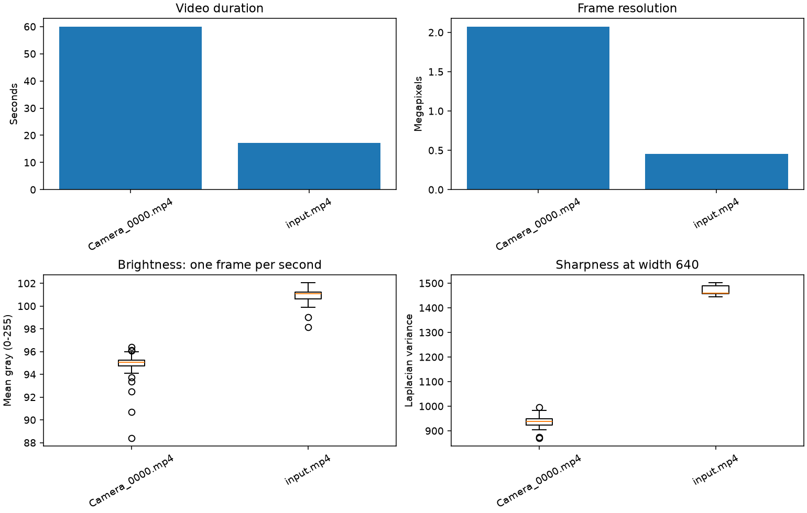
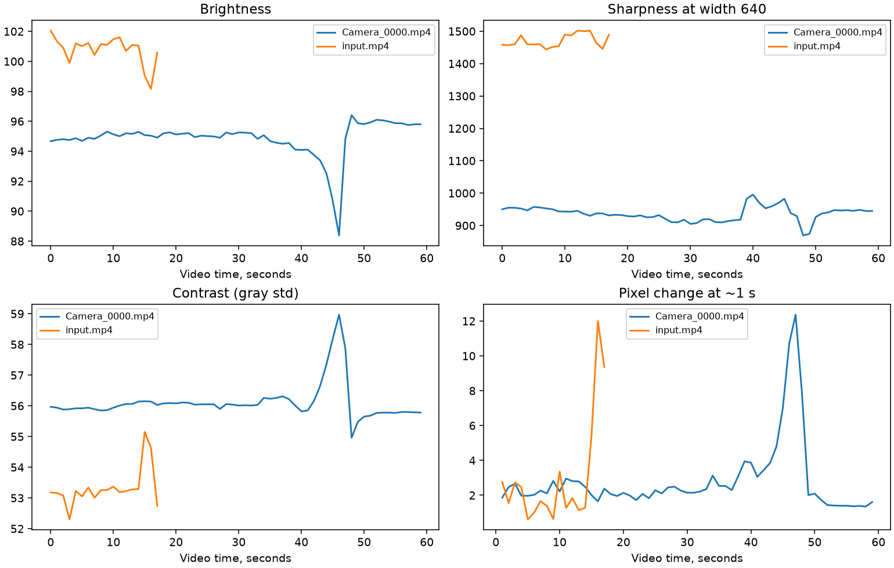

# EDA: input.mp4 и Camera_0000.mp4

В анализ входят **только два файла**: `input.mp4` и `Camera_0000.mp4`.
Остальные локальные ролики не учитываются ни в таблицах, ни в графиках.
`Camera_0000` выбран как минутный пример с людьми в СИЗ и без них;
`input` даёт другой ракурс, меньшее разрешение и более сложные мелкие объекты.
[Источник и доступ](../../data/README.md). Новых данных для этой итерации нет.

## Состав и объём

| Показатель | Camera_0000.mp4 | input.mp4 |
| --- | ---: | ---: |
| Размер, байт | 19 802 011 | 584 158 |
| Размер, МБ (10⁶ байт) | 19,802 | 0,584 |
| Разрешение | 1920×1080 | 898×506 |
| FPS | 30 | 25 |
| Длительность, с | 60 | 17,16 |
| Кадров по метаданным / прочитано | 1800 / 1800 | 429 / 429 |
| Кадров выборки качества | 60 | 18 |

Всего **20 386 169 байт (20,386 МБ), 77,16 секунды, 2229 кадров**.
Около 77,8% суммарного времени приходится на `Camera_0000`, поэтому показатели
по роликам приведены отдельно. В `input` примерно в 4,6 раза меньше пикселей в кадре.
Даты съёмки, реальные ID камер, происхождение и связь записей не подтверждены.
Хеши SHA256 исходников сохранены в [videos.csv](videos.csv).

Изначально аннотаций не было. Теперь есть автоматические рамки пяти классов
person/helmet/vest/no_helmet/no_vest, ID треков, статусы СИЗ, демонстрационные зоны
и кандидаты событий. Автоматические классы не являются истинным балансом нарушений.

## Методика проверки

Каждый ролик последовательно прочитан до конца. Количество декодированных кадров
совпало с метаданными; это техническая проверка, а не гарантия отсутствия скрытых
артефактов сжатия. Для качества взят примерно один кадр в секунду — **78 кадров**.
Перед измерениями кадр переведён в серый и приведён к ширине 640 с сохранением
пропорций. Яркость — среднее серого, контраст — его стандартное отклонение,
резкость — дисперсия Лапласиана. Изменение кадра — среднее абсолютное различие
с предыдущим выбранным кадром, то есть примерно через секунду, а не между соседними FPS.

Эвристические пороги: средняя яркость < 40, контраст < 10, резкость < 50,
малое изменение < 1. Доля тёмных пикселей считается при сером < 30,
светлых — при > 225. Это диагностические показатели, не разметка видимости СИЗ.

## Визуализации и выводы



1. **Объём:** один минутный ролик и один на 17,16 секунды. Набор подходит для
   отладки, но не представляет смены, редкие события и разные условия эксплуатации.
2. **Разрешение:** меньший кадр `input` особенно ограничивает распознавание касок.
   Увеличение размера входа модели не восстанавливает потерянные детали исходника.
3. **Яркость:** `Camera_0000` в среднем темнее; анализировать камеры отдельно
   полезнее, чем выводить одно среднее по всем кадрам двух разных сцен.
4. **Резкость:** глобальная метрика выше у `input`, хотя каски в нём мельче.
   Текстура стеллажей повышает показатель и не доказывает читаемость СИЗ человека.

| Качество выборки | Camera_0000.mp4 | input.mp4 |
| --- | ---: | ---: |
| Средняя яркость, 0–255 | 94,86 | 100,78 |
| Яркость: минимум / медиана / максимум | 88,38 / 95,05 / 96,41 | 98,16 / 101,08 / 102,05 |
| Медианный контраст | 56,02 | 53,22 |
| Резкость: минимум / медиана / максимум | 869,33 / 937,36 / 995,48 | 1443,93 / 1459,85 / 1501,84 |
| Медианная доля тёмных пикселей, % | 16,96 | 8,93 |
| Медианная доля светлых пикселей, % | 0,18 | 1,28 |
| Медианное изменение примерно за секунду | 2,215 | 1,662 |



В `Camera_0000` около 47-й секунды заметны падение средней яркости и всплеск
изменения кадра; при просмотре этого участка виден проезд погрузчика.
Для `input` сильные изменения видны ближе к концу, когда люди появляются крупнее.
Глобальное изменение у `input` в среднем небольшое из-за преобладания неподвижного
фона; оно не оценивает движение каждого человека и устойчивость его трека.

На выборке каждого ролика **0** срабатываний порогов темноты, низкого контраста
и резкости. При этом в `Camera_0000` тёмные участки занимают до 21,64% кадра:
средняя яркость не исключает локальных теней и перекрытия головы или торса.
Точных повторов полных выбранных кадров внутри каждого ролика — **0**.
В `input` 2 из 17 сравниваемых пар имеют изменение < 1: это похожий фон,
а не доказательство дубликатов. Межкамерные похожие кадры этим способом не проверяются.

## Объекты, треки и качество разметки

Полная предразметка пересчитана на **всех 2229 кадрах**. Получено 2583 рамки person,
962 helmet, 434 vest, 82 no_helmet и 332 no_vest. Это повторные наблюдения объектов
в кадрах, а не число уникальных работников или нарушений.

Для визуальной сверки сохранены по 10 равномерно выбранных кадров каждого видео
(включая первый и последний). Количества на этих 20 кадрах: person 33 визуально
против 23 автоматически; helmet 7 против 7; vest 21 против 8.
Среднее абсолютное расхождение количества на кадр — 0,50 / 0 / 0,65 соответственно.
Совпадение числа касок не является проверкой точности координат всех рамок.

У `input` медианная высота обнаруженной каски **14,99 пикселя**, у `Camera_0000` —
58,98. На `input` все обнаруженные каски ниже 32 пикселей; это выбранный ориентир
малого объекта, а не универсальный порог пригодности. Пропущенные объекты в эту
статистику не входят. В `input` 131 из 308 рамок людей (42,53%) не получили
подтверждённого track_id, в `Camera_0000` — 12 из 2275 (0,53%).

Статус каски unknown у 55,25% / 93,51% рамок людей (`Camera_0000` / `input`),
жилета — у 76,44% / 28,57%. Unknown нельзя считать отсутствием СИЗ.
Строгое правило выделило 4 кандидата zone в `Camera_0000` и 0 в `input`.
Событий отсутствия СИЗ > 5 секунд не выделено, хотя в `Camera_0000` визуально
есть длительный эпизод человека без каски и жилета. Это выявленный пропуск бейзлайна.

[Подробный отчёт о разметке](../annotations/README.md) содержит отдельные показатели
по роликам, размеры объектов, confidence, графики по времени и разбор этого пропуска.

## Решения по данным

- Использовать готовый детектор без обучения: двух коротких роликов недостаточно
  для обучения с нуля и независимого train/val/test. Дополнительных съёмок не планируется.
- Исправлять аннотации и проверять видимость на существующих кадрах; не превращать
  пропущенные детекции в отрицательные примеры для обучения.
- Настраивать прототип на `Camera_0000`; `input` использовать как ограниченную
  проверку другого ракурса после фиксации настроек. Оба ролика уже просмотрены,
  поэтому это исследовательское сравнение, а не слепой независимый test.
- Проверять все доступные интервалы, включая участки без тревог. Извлечение ещё
  кадров не создаёт независимых сцен; число FP за смену по 77,16 секунды не оценивается.
- В Git хранить агрегаты и аннотации, оригиналы и видео с наложением — локально.

## Воспроизведение

Из корня репозитория, Python 3.12+ (проверено на 3.13.7):

```bash
python -m pip install -r requirements-eda.txt
python scripts/eda.py --files Camera_0000.mp4 input.mp4
```

Те же два файла выбраны по умолчанию. Скрипт сохраняет [videos.csv](videos.csv),
[samples.csv](samples.csv), `overview.png` и `quality_timeline.png`.
Все 78 строк выборки и все значения таблиц получены кодом; выводы добавлены по
измерениям и визуальному просмотру. Для повторного расчёта нужны оба исходных MP4.
